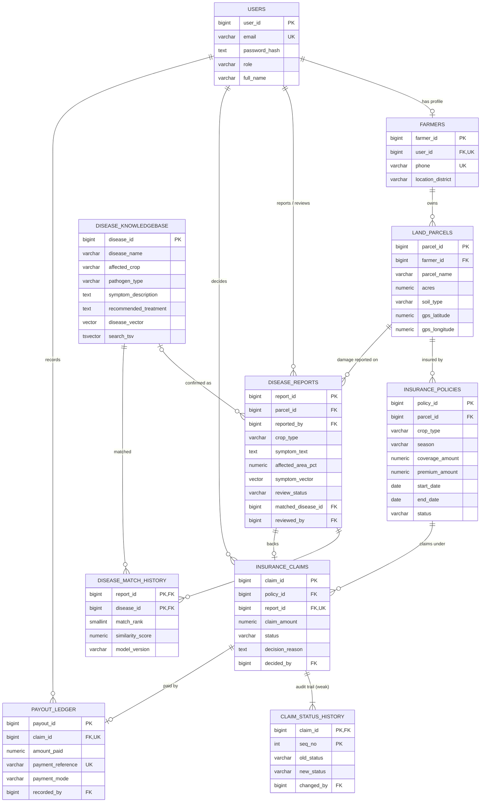
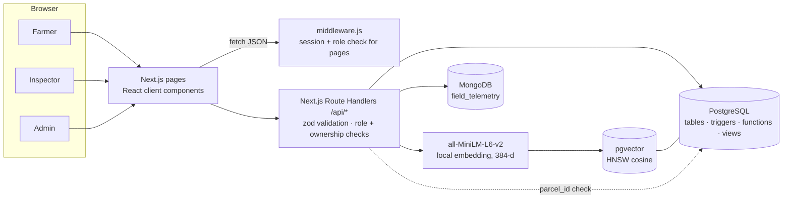

# AgriShield: Project Report

**An Integrated Crop Disease Intelligence and Agricultural Insurance Management System**
DBMS Experiential Learning, Level 3 · PES University · Team of 2

> Fill in before submission: team member names and SRNs, section, GitHub URL, and screenshots in section 13.

---

## 1. Problem statement

When a farmer's crop is damaged by disease, four kinds of information are needed to settle an insurance claim fairly: *which* land and crop were affected, *what* the damage looks like, *which disease* it most likely is, and *what the policy covers*. Today these live in separate places: land records, paper complaint forms, extension-office knowledge, and the insurer's claim system. Claims are hard to trace back to the parcel and the confirmed cause, farmers describe symptoms in everyday words that don't match the technical names in disease references, and decisions and payments are not recorded in one auditable place.

AgriShield puts all of this into one database-backed web application. A farmer reports what they see in plain words; the system finds diseases with similar symptoms using vector search; an inspector confirms the disease; the farmer files a claim under an eligible policy; an administrator approves or rejects it, and an approved claim's payout is recorded in the same transaction. Field sensor data sits alongside as supporting evidence.

Disease matching is **decision support only**. Similarity scores are retrieval scores, not diagnoses, and no claim is approved or rejected automatically.

## 2. Objectives

1. Model farmers, parcels, policies, symptom reports, claims and payouts with full referential integrity.
2. Enforce insurance rules inside the database (eligibility, coverage limits, one payout per approved claim, final decisions) so they hold no matter which client writes the data.
3. Let farmers search a disease knowledge base in their own words using embeddings and pgvector, and compare this with keyword (full-text) search.
4. Store variable-shape IoT and drone telemetry in MongoDB and analyse it with aggregation pipelines.
5. Provide a Next.js interface with three roles and role-based access control.
6. Demonstrate transactions, triggers, stored functions, views, several index types, full-text search, NoSQL aggregation and vector similarity search.

## 3. Scope

**In scope:** farmer registration and login; parcel management; policy issue and cancellation (admin); symptom reporting with automatic disease suggestions; inspector review; claim filing with eligibility checks; claim approval with atomic payout recording; rejection with reasons; status audit trail; disease knowledge-base curation; telemetry ingestion and analytics; dashboards.

**Out of scope:** image-based disease classification; automatic claim decisions; real bank, insurer or government (PMFBY) integration; real-world insurance regulations; physical sensors (telemetry is simulated); yield or weather forecasting.

## 4. Users and roles

| Role | Can do |
|---|---|
| **Farmer** | Register, manage own parcels, view own policies, report damage, search diseases, file and track claims, view and add sensor readings |
| **Agricultural inspector** | Review symptom reports, confirm a disease or dismiss a report, curate the knowledge base, view all parcels |
| **Insurance administrator** | Issue and cancel policies, approve (with payout) or reject claims, view analytics, everything an inspector can view |

## 5. Functional requirements

| ID | Requirement | Where it is enforced |
|---|---|---|
| FR1 | Farmers self-register; one user account per farmer, unique email and phone | `users`, `farmers` UNIQUE; register API transaction |
| FR2 | Passwords stored only as bcrypt hashes | bcryptjs + `CHECK (password_hash LIKE '$2%')` |
| FR3 | A farmer sees and changes only their own parcels, reports, claims | ownership checks in every API route |
| FR4 | Parcel area > 0, valid GPS range, allowed soil types | CHECK constraints |
| FR5 | No two non-cancelled policies for the same parcel and crop may overlap in time | `EXCLUDE USING gist` constraint |
| FR6 | A symptom report is embedded and matched to the top 5 diseases, and the matches are stored | `/api/reports` + `fn_match_diseases` + `disease_match_history` |
| FR7 | Inspector confirms a disease (must pick one) or dismisses the report; review is final | CHECK `chk_reviewed_has_disease`, API guard |
| FR8 | A claim needs an active policy, today within its period, same parcel and crop as the report, report not dismissed, amount ≤ remaining cover | trigger `claim_validate` |
| FR9 | One claim per report | `UNIQUE (report_id)` |
| FR10 | Only PENDING → APPROVED / REJECTED; decisions cannot change | trigger `claim_status_guard` |
| FR11 | Approval and payout happen together or not at all | `fn_approve_claim_and_pay` inside a transaction |
| FR12 | Payout only for approved claims, ≤ claimed amount, unique reference, at most one per claim | trigger `payout_validate`, UNIQUE constraints |
| FR13 | Every claim status change is logged with who and when | trigger `claim_history` → `claim_status_history` |
| FR14 | Telemetry accepted only for existing parcels the user owns; impossible readings rejected | API parcel check + MongoDB `$jsonSchema` validator |
| FR15 | Admin analytics: claims by status and crop, payouts by month, disease hotspots, policy utilisation, sensor risk signals | views + aggregation pipelines |

**Non-functional:** parameterised SQL only; secrets in environment variables; HTTP-only signed session cookie; responsive layout and visible keyboard focus; the app keeps working (minus telemetry) if MongoDB is down.

## 6. Design decisions

The handoff document listed open questions. They were resolved as follows.

| Question | Decision | Reason |
|---|---|---|
| Separate DISEASE_REPORT table? | **Yes** (`disease_reports`) | A farmer should be able to report damage and get advice without filing a claim. Claims reference a report. |
| How is a diagnosis stored? | **Both**: `disease_match_history` stores every search result (score, rank, model) and `disease_reports.matched_disease_id` stores the inspector-confirmed disease | Separates what the algorithm suggested from what a human confirmed; both are auditable |
| Payout cardinality | **1 : 0..1** (`UNIQUE claim_id`) | Simple and matches the brief; instalments listed as future work |
| Policy status | **ACTIVE / EXPIRED / CANCELLED** only; no CLAIMED | A policy can have several claims. Claim state lives on the claim. |
| Overlapping policies | Not allowed for same parcel + crop unless cancelled | `EXCLUDE` constraint |
| Who curates diseases | Inspectors and admins; each entry has `source_reference` and `created_by` | Provenance for advisory content |
| Embedding model | **all-MiniLM-L6-v2** (384 dimensions), runs locally | Free, no API key, small (~25 MB), good for short English text |
| Weak entity | **`claim_status_history`**, PK `(claim_id, seq_no)` | A status change has no meaning without its claim; it is genuinely identified by owner key + partial key |
| Login model | Separate `users` table with a role; `farmers` is a 1:1 profile | Inspectors and admins are not farmers but still need logins |

## 7. Database choice and justification

| Data | Database | Justification |
|---|---|---|
| Users, farmers, parcels, policies, reports, claims, payouts, history | **PostgreSQL** | Fixed, well-understood structure. Money and legal decisions need foreign keys, CHECK constraints, triggers and ACID transactions. Reports need joins across five tables. |
| Sensor, weather-station and drone readings | **MongoDB** | Each device sends different fields (soil sensors: moisture, pH; weather stations: rain, humidity, leaf wetness; drones: NDVI and image references, no sensor fields at all). New device types add new fields with no migration. Readings are written often, read mostly by parcel and time, and summarised by aggregation pipelines. No cross-record transactions are needed. |
| Disease and symptom embeddings | **pgvector in PostgreSQL** | Farmers say “brown rings like a target” while the reference says “concentric lesions”; keyword search misses this, vector search does not. Keeping vectors in the same database as the catalogue means the vector, its disease row and its match history stay consistent in one transaction, and a vector query can be combined with SQL filters (crop) and joins. A separate vector server would add a second copy of the catalogue to keep in sync. |

**Cross-database link:** telemetry documents carry `parcel_id` and `farmer_id`. MongoDB cannot enforce a foreign key into PostgreSQL, so the API looks the parcel up in PostgreSQL (and checks ownership) before every telemetry read or write, and the setup script takes its parcel ids from PostgreSQL.

## 8. ER diagram

Crow's-foot notation (renders on GitHub). `||` exactly one, `o|` zero or one, `o{` zero or many, `|{` one or many.



**Outside the relational diagram:** the MongoDB collection `field_telemetry` relates to `LAND_PARCELS` as 1 : N through the logical reference `parcel_id`.

### 8.1 Entities, keys and relationships

| Relationship | Cardinality | Participation | Implemented by |
|---|---|---|---|
| User – Farmer profile | 1 : 0..1 | only FARMER users have one | `farmers.user_id` FK + UNIQUE |
| Farmer – Parcel | 1 : N | parcel total | `land_parcels.farmer_id` FK NOT NULL |
| Parcel – Policy | 1 : N (over time) | policy total | `insurance_policies.parcel_id` FK |
| Parcel – Report | 1 : N | report total | `disease_reports.parcel_id` FK |
| Report – Disease (suggested) | M : N | partial | associative entity `disease_match_history` |
| Report – Disease (confirmed) | N : 0..1 | partial | `disease_reports.matched_disease_id` FK, nullable |
| Policy – Claim | 1 : N | claim total | `insurance_claims.policy_id` FK |
| Report – Claim | 1 : 0..1 | partial | `insurance_claims.report_id` FK + UNIQUE |
| Claim – Status history | 1 : N (≥ 1) | history total, **identifying** | PK `(claim_id, seq_no)`, ON DELETE CASCADE |
| Claim – Payout | 1 : 0..1 | partial | `payout_ledger.claim_id` FK + UNIQUE |

**Strong entities:** USERS, FARMERS, LAND_PARCELS, INSURANCE_POLICIES, DISEASE_KNOWLEDGEBASE, DISEASE_REPORTS, INSURANCE_CLAIMS, PAYOUT_LEDGER (each has its own surrogate key).
**Weak entity:** CLAIM_STATUS_HISTORY, owner INSURANCE_CLAIMS, partial key `seq_no`. Draw it as a double rectangle with a double-diamond identifying relationship in Chen notation.
**Associative entity:** DISEASE_MATCH_HISTORY resolves the M:N between reports and diseases and carries its own attributes (rank, score, model).
**MongoDB documents** each have their own `_id`, so they are not weak entities.

## 9. Relational schema

Underline = primary key, *italic* = foreign key.

- USERS(<u>user_id</u>, full_name, email, password_hash, role, is_active, created_at)
- FARMERS(<u>farmer_id</u>, *user_id*, phone, location_district, created_at)
- LAND_PARCELS(<u>parcel_id</u>, *farmer_id*, parcel_name, survey_number, acres, soil_type, gps_latitude, gps_longitude, created_at)
- INSURANCE_POLICIES(<u>policy_id</u>, *parcel_id*, crop_type, season, coverage_amount, premium_amount, start_date, end_date, status, created_at)
- DISEASE_KNOWLEDGEBASE(<u>disease_id</u>, disease_name, affected_crop, pathogen_type, symptom_description, recommended_treatment, source_reference, disease_vector, embedding_model, search_tsv, *created_by*, updated_at)
- DISEASE_REPORTS(<u>report_id</u>, *parcel_id*, *reported_by*, crop_type, symptom_text, affected_area_pct, evidence_uri, symptom_vector, review_status, *matched_disease_id*, *reviewed_by*, inspector_notes, reported_at, reviewed_at)
- DISEASE_MATCH_HISTORY(<u>*report_id*, *disease_id*</u>, match_rank, similarity_score, model_version, matched_at)
- INSURANCE_CLAIMS(<u>claim_id</u>, *policy_id*, *report_id*, claim_amount, status, decision_reason, *decided_by*, filed_at, decided_at)
- CLAIM_STATUS_HISTORY(<u>*claim_id*, seq_no</u>, old_status, new_status, *changed_by*, note, changed_at)
- PAYOUT_LEDGER(<u>payout_id</u>, *claim_id*, amount_paid, payment_reference, payment_mode, payout_date, *recorded_by*)

**Normalisation:** all tables are in 3NF. Every non-key attribute depends on the whole key and nothing but the key. Farmer name lives only in `users`, the claim's crop comes from its policy rather than being copied, and derived values (remaining cover, totals) are computed by functions and views instead of stored. Two values are stored deliberately: `disease_reports.crop_type`, because a parcel grows different crops over time and the report must record which one was damaged; and the generated column `search_tsv`, which PostgreSQL keeps in sync automatically.

## 10. Data dictionary

### users
| Column | Type | Constraints | Meaning |
|---|---|---|---|
| user_id | BIGINT identity | PK | Login account id |
| full_name | VARCHAR(100) | NOT NULL, ≥ 2 chars | Display name |
| email | VARCHAR(120) | NOT NULL, UNIQUE, lowercase, email pattern | Login id |
| password_hash | TEXT | NOT NULL, must start `$2` (bcrypt) | Never plain text |
| role | VARCHAR(10) | IN (FARMER, INSPECTOR, ADMIN) | Access level |
| is_active | BOOLEAN | default TRUE | Disabled accounts can't log in |
| created_at | TIMESTAMPTZ | default now() | |

### farmers
| Column | Type | Constraints | Meaning |
|---|---|---|---|
| farmer_id | BIGINT identity | PK | |
| user_id | BIGINT | FK → users, UNIQUE, CASCADE | Login for this farmer |
| phone | VARCHAR(10) | UNIQUE, `^[6-9][0-9]{9}$` | Indian mobile number |
| location_district | VARCHAR(60) | NOT NULL | Used for hotspot analysis |

### land_parcels
| Column | Type | Constraints | Meaning |
|---|---|---|---|
| parcel_id | BIGINT identity | PK | |
| farmer_id | BIGINT | FK → farmers, RESTRICT | Owner |
| parcel_name | VARCHAR(60) | UNIQUE per farmer | Farmer's own name for the plot |
| survey_number | VARCHAR(30) | optional | Land record number |
| acres | NUMERIC(8,2) | > 0 and ≤ 1000 | Area |
| soil_type | VARCHAR(10) | IN (RED, BLACK, ALLUVIAL, LATERITE, SANDY, CLAY, LOAMY) | |
| gps_latitude / gps_longitude | NUMERIC(9,6) | −90..90 / −180..180 | Location |

### insurance_policies
| Column | Type | Constraints | Meaning |
|---|---|---|---|
| policy_id | BIGINT identity | PK | |
| parcel_id | BIGINT | FK → land_parcels, RESTRICT | Insured parcel |
| crop_type | VARCHAR(40) | NOT NULL | Insured crop |
| season | VARCHAR(6) | IN (KHARIF, RABI, ZAID) | |
| coverage_amount | NUMERIC(12,2) | > 0 | Maximum total payout |
| premium_amount | NUMERIC(12,2) | ≥ 0 and ≤ coverage | |
| start_date / end_date | DATE | end > start | Coverage period |
| status | VARCHAR(10) | IN (ACTIVE, EXPIRED, CANCELLED) | Lifecycle only |
| *(table)* | | EXCLUDE: same parcel + crop, overlapping dates, not cancelled | No double insurance |

### disease_knowledgebase
| Column | Type | Constraints | Meaning |
|---|---|---|---|
| disease_id | BIGINT identity | PK | |
| disease_name, affected_crop | VARCHAR | UNIQUE together | Same name allowed on different crops |
| pathogen_type | VARCHAR(10) | IN (FUNGAL, BACTERIAL, VIRAL, PEST, NUTRIENT, OTHER) | |
| symptom_description | TEXT | ≥ 20 chars | Text that gets embedded |
| recommended_treatment | TEXT | NOT NULL | Advisory only |
| source_reference | VARCHAR(200) | | Provenance |
| disease_vector | VECTOR(384) | HNSW index, cosine | Embedding of name + crop + symptoms |
| embedding_model | VARCHAR(60) | | Which model produced the vector |
| search_tsv | TSVECTOR | generated, GIN index | Full-text search |
| created_by | BIGINT | FK → users | Curator |
| updated_at | TIMESTAMPTZ | set by trigger | |

### disease_reports
| Column | Type | Constraints | Meaning |
|---|---|---|---|
| report_id | BIGINT identity | PK | |
| parcel_id | BIGINT | FK → land_parcels | Where |
| reported_by | BIGINT | FK → users | Who |
| crop_type | VARCHAR(40) | NOT NULL | Which crop was damaged |
| symptom_text | TEXT | ≥ 15 chars | Farmer's own words |
| affected_area_pct | NUMERIC(5,2) | > 0 and ≤ 100 | Share of the parcel affected |
| evidence_uri | TEXT | optional | Photo reference |
| symptom_vector | VECTOR(384) | HNSW index | Embedding of the report |
| review_status | VARCHAR(10) | IN (SUBMITTED, REVIEWED, DISMISSED) | |
| matched_disease_id | BIGINT | FK → disease_knowledgebase; required if REVIEWED | Inspector-confirmed disease |
| reviewed_by, reviewed_at | | required unless SUBMITTED | |
| inspector_notes | TEXT | | |

### disease_match_history
| Column | Type | Constraints | Meaning |
|---|---|---|---|
| report_id, disease_id | BIGINT | composite PK, both FK (CASCADE) | |
| match_rank | SMALLINT | 1..10 | Position in results |
| similarity_score | NUMERIC(5,4) | −1..1 | 1 − cosine distance |
| model_version | VARCHAR(60) | NOT NULL | For reproducibility |

### insurance_claims
| Column | Type | Constraints | Meaning |
|---|---|---|---|
| claim_id | BIGINT identity | PK | |
| policy_id | BIGINT | FK → insurance_policies | |
| report_id | BIGINT | FK → disease_reports, UNIQUE | One claim per report |
| claim_amount | NUMERIC(12,2) | > 0, ≤ remaining cover (trigger) | |
| status | VARCHAR(8) | IN (PENDING, APPROVED, REJECTED); forced PENDING on insert | |
| decision_reason | TEXT | required when REJECTED | |
| decided_by, decided_at | | required unless PENDING | |

### claim_status_history (weak entity)
| Column | Type | Constraints | Meaning |
|---|---|---|---|
| claim_id | BIGINT | PK part, FK → insurance_claims CASCADE | Owner |
| seq_no | INT | PK part (partial key), > 0 | 1, 2, 3… within a claim |
| old_status, new_status | VARCHAR(8) | | Transition |
| changed_by | BIGINT | FK → users | From `app.current_user_id` |
| note, changed_at | | | |

### payout_ledger
| Column | Type | Constraints | Meaning |
|---|---|---|---|
| payout_id | BIGINT identity | PK | |
| claim_id | BIGINT | FK, UNIQUE | At most one payout per claim |
| amount_paid | NUMERIC(12,2) | > 0, ≤ claim_amount (trigger) | |
| payment_reference | VARCHAR(40) | UNIQUE | Bank or DBT transaction id |
| payment_mode | VARCHAR(6) | IN (DBT, NEFT, UPI, CHEQUE) | |
| recorded_by | BIGINT | FK → users | |

## 11. Implementation

### 11.1 SQL (PostgreSQL)

| File | Shows |
|---|---|
| `01_schema.sql` | CREATE TABLE, DROP TABLE, PK, FK with RESTRICT/CASCADE/SET NULL, CHECK, UNIQUE, composite UNIQUE, EXCLUDE, generated column, VECTOR column |
| `02_functions_triggers.sql` | 5 triggers, 7 stored functions |
| `03_indexes.sql` | 11 indexes of 6 kinds |
| `04_views.sql` | 4 views |
| `06_queries.sql` | 16 query groups |
| `07_transaction_demo.sql` | COMMIT, ROLLBACK, SAVEPOINT |
| `08_alter_drop_demo.sql` | ALTER ADD/DROP COLUMN, ADD/DROP CONSTRAINT, ALTER TYPE, RENAME, COMMENT, DROP TABLE, DROP INDEX |

**Triggers**

| Trigger | When | What it does |
|---|---|---|
| `claim_validate` | BEFORE INSERT on claims | Policy active and in period; report on same parcel and crop and within the period; report not dismissed; amount ≤ remaining cover; forces status PENDING |
| `claim_status_guard` | BEFORE UPDATE on claims | Only PENDING can change; stamps `decided_at` and `decided_by` |
| `claim_history` | AFTER INSERT / UPDATE OF status | Writes the next `seq_no` row into the weak entity |
| `payout_validate` | BEFORE INSERT/UPDATE on payouts | Claim must be APPROVED; amount ≤ claimed |
| `disease_touch` | BEFORE UPDATE on diseases | If the text changes, clears the old vector so it gets re-embedded |

**Stored functions:** `fn_approve_claim_and_pay` (locks the claim row with `FOR UPDATE`, approves, inserts payout; any failure undoes both), `fn_reject_claim`, `fn_policy_is_eligible`, `fn_policy_remaining_cover`, `fn_match_diseases` (vector search), `fn_expire_policies`, `fn_app_user`.

**Indexes**

| Index | Kind | Speeds up |
|---|---|---|
| idx_parcels_farmer, idx_policies_parcel, idx_claims_policy | B-tree on FK | Every dashboard join (PostgreSQL doesn't index FKs automatically) |
| idx_reports_parcel_time | Composite B-tree | A parcel's reports, newest first |
| idx_claims_status_filed | Composite B-tree | Admin queue: pending, oldest first |
| idx_policies_status_end | Composite B-tree | Eligibility and expiry checks |
| idx_reports_unreviewed | **Partial** (`WHERE review_status='SUBMITTED'`) | Inspector queue; stays small |
| idx_disease_crop_lower | **Expression** `lower(affected_crop)` | Case-insensitive crop filter |
| idx_disease_vector_hnsw, idx_report_vector_hnsw | **HNSW** `vector_cosine_ops` | Nearest-neighbour search |
| idx_disease_fts | **GIN** | Full-text search |
| no_overlapping_policies | **GiST** (from EXCLUDE) | Overlap check on insert |

`EXPLAIN` evidence (from `06_queries.sql` Q16): the pending-claims query uses `Bitmap Index Scan on idx_claims_status_filed`; the full-text query uses `Bitmap Index Scan on idx_disease_fts`; the parcel lookup uses `Index Scan using idx_parcels_farmer`.

**Views:** `v_farmer_dashboard` (per-farmer totals, using sub-selects so joins don't multiply rows), `v_claim_details` (one row per claim joining seven tables, used by both claim pages), `v_disease_hotspots` (confirmed cases by district and disease), `v_policy_utilisation` (share of cover paid out).

### 11.2 NoSQL (MongoDB)

**Collection:** `field_telemetry` (database `agrishield`).

Three document shapes live in the same collection:

```json
{ "parcel_id": 1, "farmer_id": 1, "device_id": "SOIL-1-A", "source": "SOIL_SENSOR",
  "timestamp": "2026-10-31T07:00:00Z",
  "sensor_readings": { "soil_moisture": 31.4, "soil_ph": 6.62, "soil_temp": 27.9 } }

{ "parcel_id": 1, "farmer_id": 1, "device_id": "WX-1", "source": "WEATHER_STATION",
  "timestamp": "2026-10-31T12:00:00Z",
  "sensor_readings": { "air_temp": 29.1, "humidity": 88.0, "rainfall_mm": 12.5, "leaf_wetness_hrs": 7.2 } }

{ "parcel_id": 1, "farmer_id": 1, "device_id": "DRONE-01", "source": "DRONE",
  "timestamp": "2026-10-25T09:30:00Z",
  "drone_scan_metadata": { "imagery_type": "MULTISPECTRAL", "ndvi_mean": 0.61,
                           "canopy_cover_pct": 78.2, "image_ref": "scans/p1/2026-10-25.tif" } }
```

**Validation:** a `$jsonSchema` validator (strict) requires `parcel_id, farmer_id, device_id, source, timestamp`, restricts `source` to four values and checks ranges (pH 0–14, moisture and humidity 0–100, NDVI −1..1), while leaving other sensor fields free. The setup script proves it by trying to insert a pH of 22, which is rejected.

**Indexes:** `{parcel_id: 1, timestamp: -1}` (parcel's latest readings and date-range aggregations), `{farmer_id: 1, timestamp: -1}`, `{source: 1}`.

**Aggregation pipelines** (`src/lib/telemetryPipelines.mjs`):
1. *Daily averages* per parcel: `$match` → `$group` by `$dateTrunc` day with `$avg` and `$sum` → `$sort` → `$project` with `$round`. `$avg` simply skips documents that lack a field, which suits mixed device types.
2. *Disease-risk signals*: counts readings with humidity ≥ 85% **and** leaf wetness ≥ 6 h (conditions that favour fungal disease), counts dry-soil readings, and finds the lowest drone NDVI per parcel.
3. *Source breakdown*: documents and distinct parcels per device type (`$addToSet` + `$size`).

### 11.3 Vector search (pgvector)

| Question from the brief | Answer |
|---|---|
| What is embedded? | Each disease: `"<name>. Crop: <crop>. <symptom description>"`. Each farmer report: `"Crop: <crop>. <symptom text>"`. |
| Which model? | `Xenova/all-MiniLM-L6-v2` (sentence-transformers), run locally with transformers.js. Mean pooling, L2-normalised, **384 dimensions**. No API key, no per-request cost. |
| How are vectors stored? | `VECTOR(384)` columns in `disease_knowledgebase` and `disease_reports`, each with an **HNSW** index using `vector_cosine_ops`. The model name is stored next to each disease vector and each match row. |
| Similarity metric | **Cosine distance** (`<=>`); shown to users as similarity = 1 − distance. |
| How are results retrieved? | (1) Embed the query text in the API. (2) `fn_match_diseases(vector, crop, k)` filters by the reported crop (falls back to all crops if the catalogue has none for it), orders by `<=>` and returns the top k. (3) For reports, the top 5 are saved in `disease_match_history` in the same transaction as the report. (4) An inspector sees them, plus the 3 most similar *other* reports (report-to-report search) to spot spread between farms. |
| Keeping vectors fresh | `disease_touch` trigger clears a vector when its text changes; `npm run embed` fills every NULL vector. New diseases added in the app are embedded on save. |

**Why not keyword search alone?** `06_queries.sql` Q11 shows a farmer-style query (“yellow stripes leaves”) returning **zero rows** from full-text search because the words don't line up with the reference text. Vector search compares meaning instead, so it can still surface Yellow (stripe) rust; test V03 records the actual ranking. The disease library page shows both side by side.

### 11.4 Important queries

All in `db/postgres/06_queries.sql`; each is used somewhere in the app.

| # | Concept | Purpose |
|---|---|---|
| Q1 | 5-table JOIN | Claims with policy, parcel and farmer |
| Q2 | LEFT JOIN + GROUP BY | Parcels and acres per farmer, including farmers with none |
| Q3 | GROUP BY + HAVING | Farmers with more than one parcel |
| Q4 | Aggregates (COUNT, SUM, COALESCE) | Claimed vs paid by status |
| Q5 | NOT EXISTS subquery | Active policies never claimed |
| Q6 | Correlated subquery | Claims above their crop's average |
| Q7 | IN subquery | Districts with pending claims |
| Q8 | Window function (RANK) | Claims ranked within each district |
| Q9 | Stored function in WHERE | Eligible policies for the claim form |
| Q10 | ORDER BY + LIMIT on view | Admin queue |
| Q11 | Full-text search | Keyword baseline |
| Q12–13 | Vector similarity | Disease-to-disease, report-to-report |
| Q14 | Views | Dashboards |
| Q15 | INSERT / UPDATE / DELETE | DML examples |
| Q16 | EXPLAIN ANALYZE | Index evidence |

Example, the Q3 HAVING query:

```sql
SELECT f.farmer_id, u.full_name, COUNT(*) AS parcel_count
FROM farmers f
JOIN users u ON u.user_id = f.user_id
JOIN land_parcels lp ON lp.farmer_id = f.farmer_id
GROUP BY f.farmer_id, u.full_name
HAVING COUNT(*) > 1;
```

Example, the vector search function:

```sql
SELECT d.disease_id, d.disease_name, ROUND((1 - (d.disease_vector <=> p_query))::numeric, 4) AS similarity
FROM disease_knowledgebase d
WHERE d.disease_vector IS NOT NULL
  AND (p_crop IS NULL OR lower(d.affected_crop) = lower(p_crop))
ORDER BY d.disease_vector <=> p_query
LIMIT p_k;
```

### 11.5 Transactions

1. **Approve + pay** (`/api/claims/[id]/decision` → `fn_approve_claim_and_pay`): claim row locked `FOR UPDATE`, status updated, payout inserted, history row written by trigger. If the payout insert fails (duplicate reference, amount too high), PostgreSQL rolls back the approval as well.
2. **Register**: the `users` row and `farmers` row are inserted together; a duplicate phone undoes the user row too (verified: no orphan user left).
3. **Report + matches**: the report, its vector and its top-5 match rows are saved together.
4. `07_transaction_demo.sql` shows an explicit `BEGIN … ROLLBACK` after a failure and a `SAVEPOINT` that undoes only a bad step while the rest commits.

The API passes the acting user into the database with `set_config('app.current_user_id', …, true)` (transaction-local), which the audit trigger reads.

## 12. System architecture



**Request flow, report damage:** page → `POST /api/reports` → zod validates → ownership check → text embedded → transaction: insert report with vector, `fn_match_diseases`, insert match rows → JSON back with the matches.

**API routes**

| Method and route | Role | Purpose |
|---|---|---|
| POST /api/auth/register, /login, /logout; GET /me | public / any | Accounts and session |
| GET, POST /api/parcels; DELETE /api/parcels/[id] | farmer (all roles read) | Parcels |
| GET, POST /api/policies; PATCH /api/policies/[id] | admin writes | Issue and cancel |
| GET, POST /api/reports; GET, PATCH /api/reports/[id] | farmer posts, inspector reviews | Reports and matches |
| POST /api/disease-search | any | Vector vs keyword search |
| GET, POST /api/diseases | inspector/admin write | Knowledge base |
| GET, POST /api/claims; PATCH /api/claims/[id]/decision; GET …/history | farmer files, admin decides | Claims |
| GET, POST /api/telemetry | farmer writes | MongoDB readings and aggregations |
| GET /api/dashboard, /api/analytics | farmer / admin | Views and aggregates |

## 13. Application screenshots

*Add after running the app:* login, farmer overview, report damage with matches, disease library (both columns), file a claim, inspector review, admin claims (approve form and history), analytics, field sensors.

## 14. Testing

### 14.1 Database integrity tests: 21 of 21 passed

`npm run db:test` runs `09_integrity_tests.sql` inside a transaction that is rolled back. Each test tries something that must fail and checks that it does.

| # | Attempt | Rejected by |
|---|---|---|
| T01 | Parcel for unknown farmer | FK `land_parcels_farmer_id_fkey` |
| T02 | Negative acres | CHECK `land_parcels_acres_check` |
| T03 | Latitude out of range | CHECK |
| T04 | Duplicate farmer phone | UNIQUE `farmers_phone_key` |
| T05 | Invalid phone format | CHECK |
| T06 | Plain-text password | CHECK `users_password_hash_check` |
| T07 | Policy ending before it starts | CHECK `chk_policy_dates` |
| T08 | Overlapping policy, same parcel and crop | EXCLUDE `no_overlapping_policies` |
| T09 | Claim under unknown policy | trigger |
| T10 | Claim under expired policy | trigger |
| T11 | Claim under policy not started yet | trigger |
| T12 | Claim with report from another parcel | trigger |
| T13 | Claim larger than remaining cover | trigger |
| T14 | Second claim on same report | UNIQUE `insurance_claims_report_id_key` |
| T15 | Payout on a pending claim | trigger `payout_validate` |
| T16 | Second payout for a claim | UNIQUE `payout_ledger_claim_id_key` |
| T17 | Changing a decided claim | trigger `claim_status_guard` |
| T18 | Rejecting without a reason | `fn_reject_claim` |
| T19 | Deleting a parcel that has policies | FK RESTRICT |
| T20 | Report marked REVIEWED with no disease | CHECK `chk_reviewed_has_disease` |
| T21 | Duplicate disease for the same crop | UNIQUE `uq_disease_per_crop` |

### 14.2 API and workflow tests (run against the live app)

| # | Test | Expected | Result |
|---|---|---|---|
| A01 | Login with each demo role | 200, session cookie | Pass |
| A02 | Wrong password | 401, same message as unknown email | Pass |
| A03 | Open /admin/claims logged out | Redirect to /login | Pass |
| A04 | Farmer opens /admin/claims | Redirect to / | Pass |
| A05 | Farmer calls /api/analytics | 403 | Pass |
| A06 | Add parcel with negative acres | 400 with field message | Pass |
| A07 | Register with a phone already used | 409; no orphan user row | Pass |
| A08 | Claim under policy not yet started | 400 from trigger | Pass |
| A09 | Claim above remaining cover | 400, shows remaining cover | Pass |
| A10 | Claim using another farmer's policy | 404 | Pass |
| A11 | Valid claim | 201, status PENDING, history row 1 | Pass |
| A12 | Inspector confirms report, then tries again | 200, then 400 | Pass |
| A13 | Farmer tries to approve a claim | 403 | Pass |
| A14 | Approve with an already-used payment reference | 409; claim still PENDING (rollback) | Pass |
| A15 | Approve with a new reference | 200, payout created, history row 2 | Pass |
| A16 | Reject an approved claim | 400 | Pass |
| A17 | Another farmer reads claim history | 404 | Pass |
| A18 | Delete parcel that has policies | 400 (FK RESTRICT) | Pass |
| A19 | Cancel policy with an open claim | 400 | Pass |
| A20 | Issue overlapping policy (lower-case crop) | 409 (EXCLUDE; crop name normalised first) | Pass |
| A21 | Production build (`next build`) | Compiles, 33 routes | Pass |

### 14.3 Still to run on your own machine

These need internet access or a MongoDB server that were not available in the build environment. Run them and record the results here:

| # | Test | How |
|---|---|---|
| V01 | Embedding dimension is 384 | `npm run embed` (throws if not 384) |
| V02 | Relevant query: “brown rings like a target on old tomato leaves” | Early blight in top 1 |
| V03 | Paraphrase: “yellow powder in lines on leaves, stains fingers” | Yellow (stripe) rust in top 3; keyword search returns 0 |
| V04 | Irrelevant query: “my tractor won't start” | All similarities low (record values) |
| V05 | Crop filter: same query with crop = Rice vs empty | Only rice diseases when filtered |
| M01 | `npm run mongo:setup` | about 580 documents (7 parcels × 30 days); pH 22 document rejected |
| M02 | `npm run mongo:demo` | Three aggregation tables print; plan uses `parcel_time` index |
| M03 | Add a manual reading with only humidity | Saved; appears in daily averages |
| M04 | Stop MongoDB, open Analytics | Page loads, telemetry section shows a message |

## 15. Individual contributions

Both members worked on the database **and** the application, as the brief requires. Commit with your own Git identity so the history shows this.

| Area | Member A: data and backend lead | Member B: application and workflow lead |
|---|---|---|
| Database design | ER model, schema, constraints (`01`), triggers and functions (`02`) | Views (`04`), review of schema and constraints |
| Database implementation | Indexes (`03`), seed data (`05`), integrity tests (`09`) | Queries (`06`), transaction and ALTER/DROP demos (`07`, `08`) |
| NoSQL and vector | pgvector function, embedding script, match storage | MongoDB collection, validator, aggregation pipelines |
| Backend | `lib/db.js`, claim and report APIs | Auth, session, middleware (RBAC), parcel, policy, telemetry APIs |
| Frontend | Disease library, knowledge base, analytics pages | Login and register, farmer pages, inspector and admin claim pages, styling |
| Docs and testing | Data dictionary, DB justification, SQL tests | README, architecture, API tests, screenshots |

## 16. Conclusion and future enhancements

AgriShield links each insurance payout back through the claim, the inspector's confirmed disease, the farmer's own description, the parcel and the policy, with every rule that protects money enforced by the database itself. Each database paradigm is used where its strengths matter: PostgreSQL for rules and money, MongoDB for irregular device data, and pgvector for matching everyday words to technical disease descriptions.

**Limitations:** telemetry is simulated; similarity scores are not calibrated probabilities; the disease catalogue is small (20 entries); advisory text is indicative only; insurance rules are a simplified academic model.

**Future enhancements:** image upload with a leaf-image classifier as a second signal; payouts in instalments (1:N); Kannada and Hindi symptom input with a multilingual embedding model; automatic outbreak alerts when many similar reports appear in one district within a few days; SMS notifications on claim decisions; scheduled job for `fn_expire_policies`; table partitioning for telemetry history; hybrid ranking that combines vector and full-text scores.
